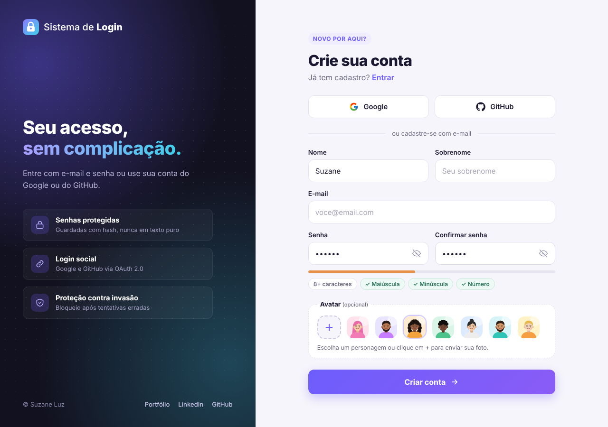
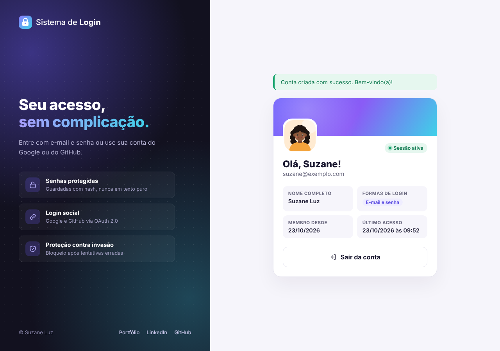
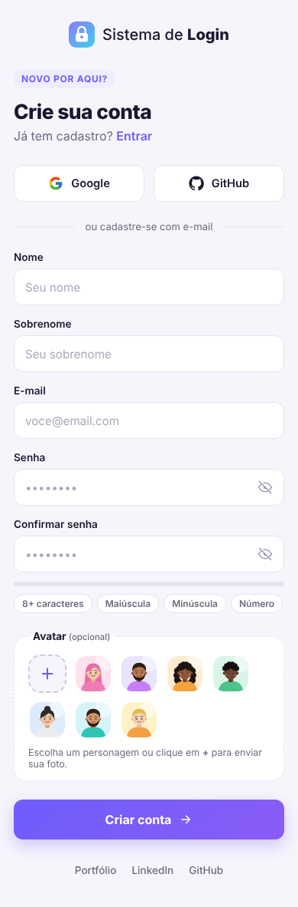

# 🔐 Sistema de Login

Projeto **full stack** de autenticação de usuários. Permite criar conta e entrar com **e-mail e senha**, ou com contas do **Google** e do **GitHub** (OAuth 2.0).

🔗 **[Ver demonstração online](https://suzaneluzz.github.io/sistema-login-web/)**


<p align="center">
  
  
</p>

## ✨ Funcionalidades

- **Cadastro** com nome, e-mail, senha e confirmação de senha
- **Login social** com Google e GitHub (OAuth 2.0)
- **Vinculação de contas**: o mesmo e-mail pode entrar por senha, Google e GitHub
- **Escolha de avatar** entre 7 opções ou **envio de foto de perfil** com pré-visualização
- **Senha forte obrigatória**, com checklist em tempo real
- **Mostrar/ocultar senha** e rótulos flutuantes nos campos
- **Painel do usuário** com dados da conta e formas de login vinculadas
- Layout **responsivo** (computador e celular)

## 🛡️ Segurança

- Senhas armazenadas com **hash** (Werkzeug/scrypt), nunca em texto puro
- **Proteção CSRF** em todos os formulários
- **Bloqueio de 5 minutos** após 5 tentativas de login erradas
- Mensagens de erro genéricas, que não revelam se um e-mail está cadastrado
- Nova sessão a cada login (evita fixação de sessão)
- Upload limitado a imagens PNG, JPG ou WEBP de até 2 MB, salvas com nome aleatório
- Chaves secretas guardadas em `.env`, fora do repositório

## 🛠️ Tecnologias

| Camada | Tecnologias |
|---|---|
| Backend | Python, Flask, Flask-Login, Flask-SQLAlchemy, Authlib |
| Banco de dados | SQLite |
| Frontend | HTML (Jinja2), CSS, JavaScript |

## 📁 Estrutura

```
sistema-login-web/
├── app.py              # Rotas, regras de negócio e OAuth
├── models.py           # Modelo de usuário (banco de dados)
├── requirements.txt    # Dependências
├── .env.example        # Modelo das variáveis de ambiente
├── templates/          # Páginas HTML do servidor Flask
├── static/             # CSS, JavaScript, avatares e uploads
├── index.html          # Demonstração estática (GitHub Pages)
└── iniciar.bat         # Atalho para rodar no Windows
```

## ▶️ Como executar

**Windows (jeito mais fácil):** dê dois cliques em `iniciar.bat`. Ele instala tudo na primeira vez e abre o site no navegador.

**Manualmente:**

```bash
git clone https://github.com/SuzaneLuzz/sistema-login-web.git
cd sistema-login-web

python -m venv .venv
# Windows:
.venv\Scripts\activate
# Linux/Mac:
source .venv/bin/activate

pip install -r requirements.txt
copy .env.example .env      # no Linux/Mac: cp .env.example .env
python app.py
```

Acesse **http://127.0.0.1:5000**.

O login com e-mail e senha já funciona sem configurar nada. Para ativar Google e GitHub, siga os passos abaixo.

## 🔑 Configurando o login com Google

1. Acesse o [Google Cloud Console](https://console.cloud.google.com/) e crie um projeto.
2. Vá em **APIs e serviços → Tela de permissão OAuth** e configure como **Externo**.
3. Vá em **Credenciais → Criar credenciais → ID do cliente OAuth** e escolha **Aplicativo da Web**.
4. Em **URIs de redirecionamento autorizados**, adicione:
   `http://127.0.0.1:5000/auth/google/callback`
5. Copie o **ID do cliente** e a **chave secreta** para `GOOGLE_CLIENT_ID` e `GOOGLE_CLIENT_SECRET` no `.env`.

## 🔑 Configurando o login com GitHub

1. Acesse **GitHub → Settings → Developer settings → OAuth Apps → New OAuth App**.
2. Preencha:
   - **Homepage URL:** `http://127.0.0.1:5000`
   - **Authorization callback URL:** `http://127.0.0.1:5000/auth/github/callback`
3. Gere um **Client secret** e copie os dois valores para `GITHUB_CLIENT_ID` e `GITHUB_CLIENT_SECRET` no `.env`.

Depois de editar o `.env`, reinicie o servidor.

> Use sempre `127.0.0.1` no navegador, e não `localhost`. O endereço precisa ser igual ao cadastrado no Google/GitHub.

## 📸 Telas

<p align="center">
  
  
</p>

---
Desenvolvido por **Suzane Luz** · [LinkedIn](https://linkedin.com/in/suzaneazevedoluz) · [GitHub](https://github.com/SuzaneLuzz)
